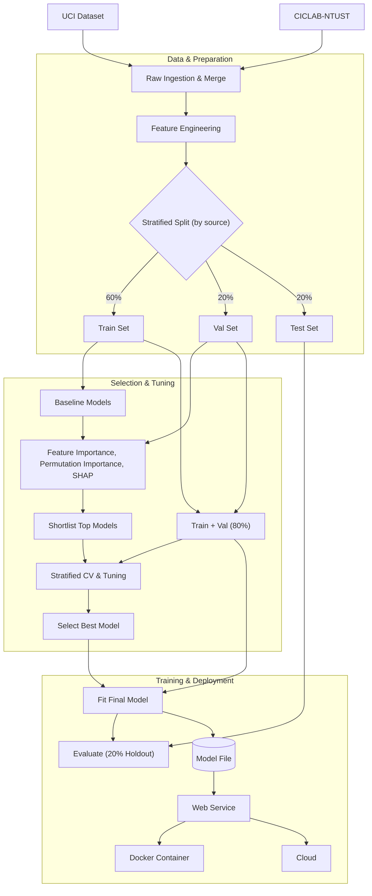
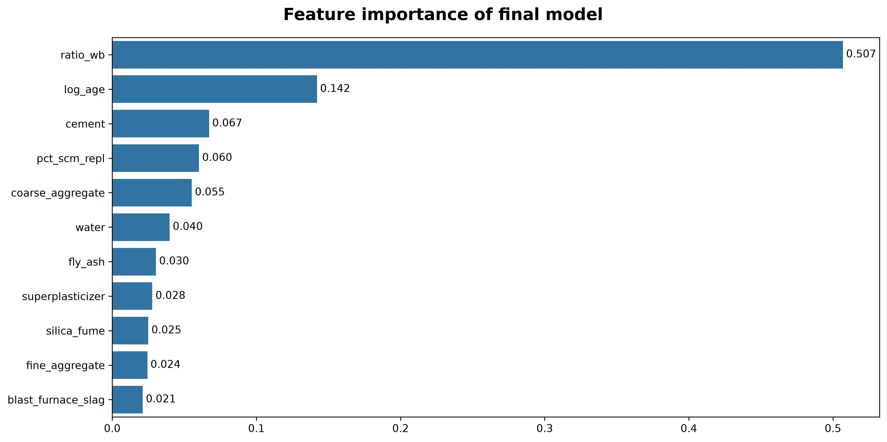
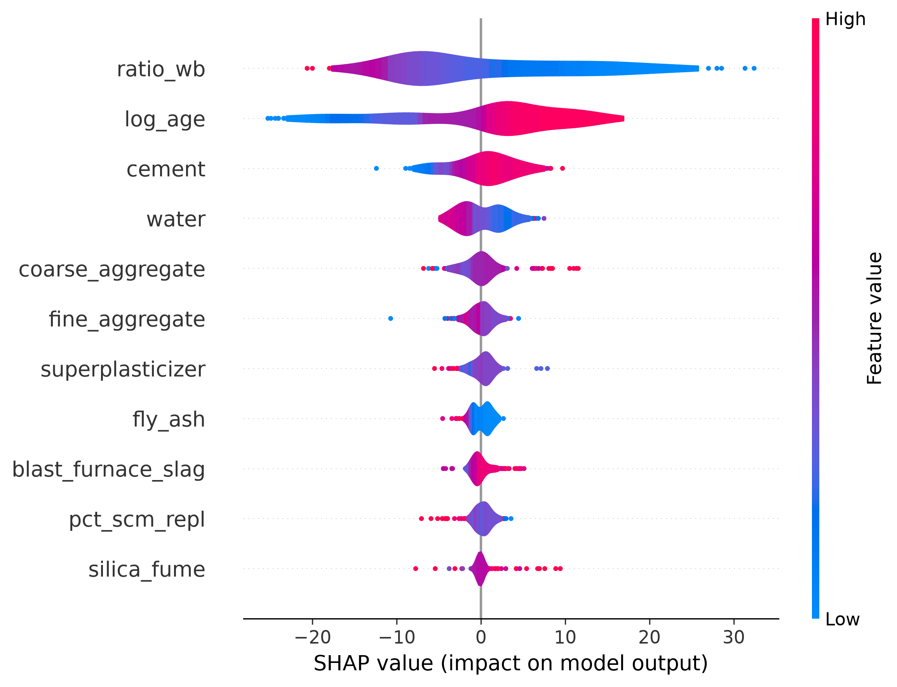
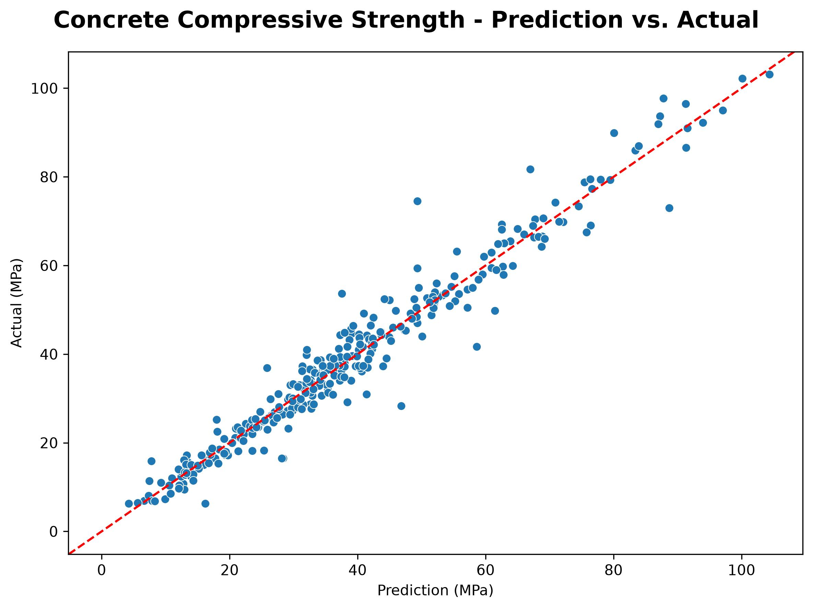

# BuhosAPI (Concrete Compressive Strength Prediction)

> **Buhos** in Filipino literally means "to pour" and is a jargon in the Philippine construction industry for *concrete pouring*.

BuhosAPI is a REST API that predicts the compressive strength of a concrete mix at a certain age given the material quantities of cement, supplementary cementitious materials (SCM), coarse and fine aggregates, water, and superplasticizer. This service houses a machine learning (ML) model that was trained using actual concrete test data to make the prediction. Overall, the project serves as a proof of concept for a solution catering civil/structural and materials engineers, batching plant operators, and academics/researchers interested in concrete technology, allowing them to do the following in a more reliable and convenient way.

1. Evaluate test result of a certain design mix relative to historical trend.
2. Setup quality control in mass producing concrete mix for projects.
3. Determine the predicted strength of job-mix concrete.
4. Determine how the material quantities be optimized while still achieving the target strength.

## Directory overview

```markdown
buhos-api/
├── container/                  # Project configuration for Docker image creation
├── data/                       # Formatted raw data in CSV (by source and merged)
│   └── raw/                    # Raw data originally in XLSX
├── docs/                       # Documentation files in Markdown
├── images/                     # Documentation images and exported plots
├── service/                    # Directory for deployment in Vercel
├── Dockerfile                  # Docker image definition  
├── nb_eda_fe.ipynb             # Notebook for EDA, feature engineering, and baseline modeling
├── nb_model_dev.ipynb          # Notebook for model training (including tuning and cross-validation)
├── nb_train_script.ipynb       # Notebook for packaging the model training as a script
├── nb_refcalcs.ipynb           # Notebook containing reference calculations for cross-checking predictions
├── csp_model.joblib            # Exported model file
├── pipeline_util.py            # Helper functions for the model pipeline
├── predict.py                  # Web service for the model
├── train.py                    # Script for model training
├── sample_predict.py           # Sample prediction by importing the model file
├── sample_request.py           # Sample prediction by using the web service
└── pyproject.toml              # Project environment configuration
```

## Setup instructions

1. Fork and/or clone the repository.
2. [Download and install uv](https://docs.astral.sh/uv/#installation)
3. [Download and install Docker](https://docs.docker.com/get-started/get-docker/)
4. Refer the succeeding subsections for specific instructions.

### 1. Local setup

While in the working directory, follow the following commands:

```bash
# Create virtual environment
uv venv --python 3.14

# Sync virtual environment to install dependencies
uv sync

# Optional: Include packages from dependency groups
uv sync --group dev

# Run the web service
uv run uvicorn predict:app --host 0.0.0.0 --port 1313
```

### 2. Docker

While in the working directory, follow the following commands:

```bash
# Build the Docker image
docker build -t buhos-api:v0.1.0 .

# Run the container
docker run -it --rm -p 1313:1313 buhos-api:v0.1.0
```

## Cloud deployment

The web service was deployed in Vercel and the docs can be [directly accessed here](https://buhos-api-cloud.vercel.app/docs) or do the following with `curl`:

1. Send a `POST` request to `https://buhos-api-cloud.vercel.app/predict` with your input.

    ```bash
    # Example
    curl -X 'POST' 'https://buhos-api-cloud.vercel.app/predict' \
        -H 'accept: application/json' \
        -H 'Content-Type: application/json' \
        -d '{
            "cement": 402,
            "blast_furnace_slag": 0,
            "fly_ash": 0,
            "silica_fume": 0,
            "coarse_aggregate": 992,
            "fine_aggregate": 732,
            "water": 205,
            "superplasticizer": 0,
            "age": 28
        }'
    ```

2. Send a `GET` request to `https://buhos-api-cloud.vercel.app/health` to check health.

    ```bash
    # Example
    curl -X 'GET' 'https://buhos-api-cloud.vercel.app/health'
    ```

Deployment was done by simply importing the repository within Vercel and making sure the environment dependencies were satisfied.

## Background

Concrete mix design involves a process of preparation in which a mix of ingredients creates the required strength and durability for the concrete structure. Because every ingredient in the mix consist of different properties, it's not an easy task to create a great concrete mix – that is it guarantees achieving the required strength at a certain age and using the optimal amount of each ingredient. It is imperative that all ingredients be tested to determine their physical properties and the environmental condition (soil condition, bearing capacity, etc.) at the project location.

Generally there are two types of concrete mix:

1. Nominal Mix
    - Materials are mixed on volume basis
    - Usually done on site (i.e. job-mix concrete)
    - Examples: 1:2:4 ratio of cement, sand, and gravel
2. Design Mix
    - Materials are mixed on weight basis
    - Common on material testing laboratories and ready mix plants
    - Standard guides are available to follow (e.g. ACI)

Given the nature of each mix, nominal mixes are often inconsistent in achieving the target strength due to estimating the required amount of every ingredient without considering its condition. On the other hand, empirical design mixes are conservative in nature, leading to excess use of materials which then increase cost. Using historical records of concrete mixes and their test result as basis, we are interested to predict the resulting strength of a certain mix proportion. The outcome would be able to give us an idea how to optimize design mixes and offer a more reliable way to estimate the material needed in creating nominal mixes.

## Dataset overview

The following datasets were used and combined given the nature of each dataset were similar based on their [referenced](https://www.semanticscholar.org/paper/Modeling-of-strength-of-high-performance-concrete-Yeh/9310cae70452ea11465f338483e79cc36a68881c) [papers](https://doi.org/10.1016/j.eswa.2022.118605).

- [UCI Machine Learning Repository](https://archive.ics.uci.edu/dataset/165/concrete+compressive+strength) (1030 observations)
- [CICLAB-NTUST High Performance Concrete Data](https://figshare.com/articles/dataset/High_Performance_Concrete_Data/25139018) (597 observations)

For the description of each variables, including the derived features during model development, view the [data dictionary](docs/data_dictionary.md).

## Process summary



### Project development

The process of creating this project is summarized as follows:

1. [EDA, Feature Engineering, and Baseline Modeling](nb_eda_fe.ipynb)
    - Load the data, transform, and merge each set into one.
    - EDA to understand the distribution of data and the relationship between variables and derived features.
    - Stratified train-validation-test split to account the original source of each observation.
    - Baseline modeling (train models with no hyperparameter tuning) to establish baseline scores, considering the case using the original features only then using transformed and added features.
    - Understand the impact of each feature through feature importance, permutation importance, and SHAP values.
    - Select top 3 models based on baseline scores and prune features based on importance and interpretability.
2. [Model development](nb_model_dev.ipynb)
    - Setup stratified k-fold using 10 folds.
    - Hyperparameter tuning each of the shortlisted models with cross-validation.
    - Choose model with the best overall score.
    - Train the final model using train and validation set, then check score with test set.
3. [Training script](nb_train_script.ipynb)
    - Setup the basic structure of the training script, including combining feature engineering and training as a single pipeline.
    - Specifically for the notebook, create reference plots for feature importance, SHAP values, and predicted vs. actual.
    - Sample predictions.
4. Setup web service in `predict.py` and sample usage through `sample_predict.py` and `sample_request.py`
5. Create [reference notebook](nb_refcalcs.ipynb) to cross-check prediction to actual calculations.

### Metrics used

- Mean Absolute Error (MAE)
- Root Mean Squared Error (RMSE)
- Mean Average Percentage Error (MAPE)
- R2 Score (Coefficient of Determination)

### Models considered

- Ridge regression (baseline model)
- Decision tree
- Random forest
- XGBoost
- Support Vector Machines

### Final model

The final model is **XGBoost** and the best scores obtained during cross-validation are summarized as shown.

| MAE | RMSE | MAPE | R2 | R2 Adjusted |
| --- | --- | --- | --- | --- |
| 3.4006 | 5.2762 | 0.1119 | 0.9227 | 0.9220 |

**Feature importance plot**


**SHAP summary plot of every feature**


**Plot of predicted value vs. actual**


## References

1. American Concrete Institute (2022). Selecting proportions for normal-density and high-density concrete - Guide (ACI PRC-211.1-22). American Concrete Institute.
2. Cheng, M.-Y., Cao, M.-T., & Dao-Thi, N.-M. (2023). A novel artificial intelligence-aided system to mine historical high-performance concrete data for optimizing mixture design. Expert Systems with Applications, 212, Article 118605. https://doi.org/10.1016/j.eswa.2022.118605
3. Yeh, I.-C. (1998). Modeling of strength of high-performance concrete using artificial neural networks. Cement and Concrete Research, 28(12), 1797–1808. https://doi.org/10.1016/S0008-8846(98)00165-3