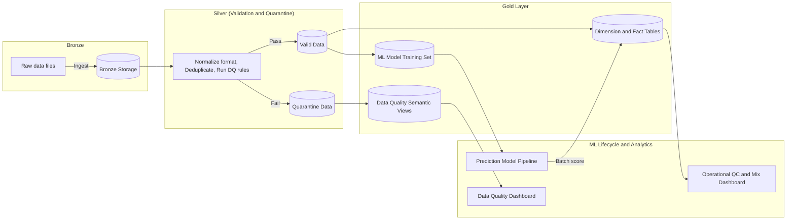
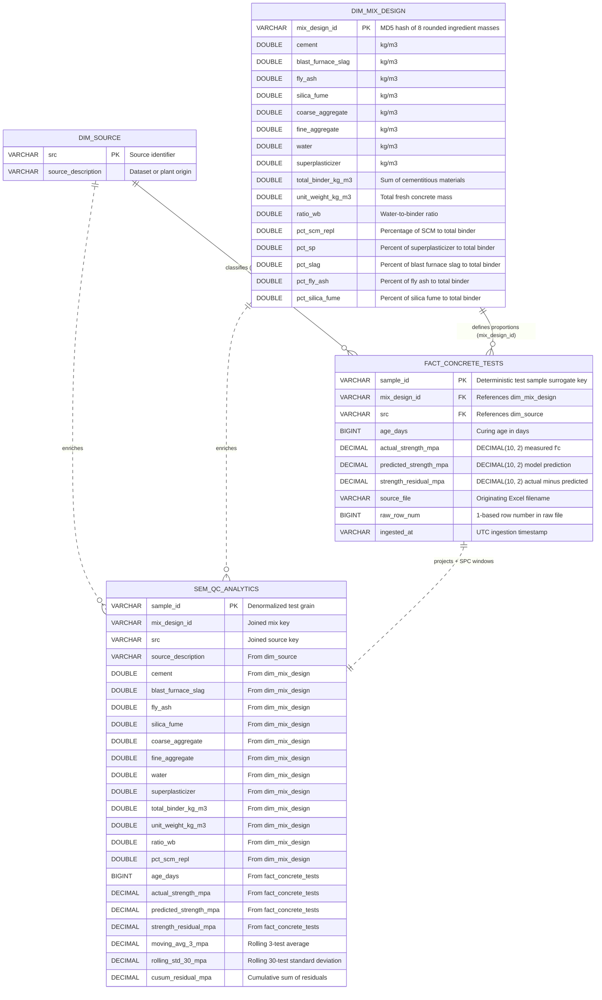

# Data Engineering Pipeline for BuhosAPI



This section covers building a basic data pipeline with governance for BuhosAPI. In the original implementation ([see notebook for reference](../nb_eda_fe.ipynb)) the raw data was processed manually (data cleaning and preprocessing), which is practical enough with relatively small datasets. To support scale, validate data, and streamline model training, building a data pipeline becomes a necessity.

Specifically, the data pipeline allow us to do the following.

- Load, transform, and store records of concrete sample from different sources.
- Perform data quality checks to segregate valid samples from invalid ones.
- Export a clean training set for the model.
- Support analytics solutions, such as dashboards, that allow us to monitor quality of concrete samples and data quality in pipeline runs.

## Setup

This section shares the same project config as the main application. Thus the following commands applies for setting up the environment.

```bash
# Create virtual environment
uv venv --python 3.14

# Sync virtual environment to install dependencies
uv sync

# Optional: Include packages from dependency groups
uv sync --group dev

```

While in working directory, run the following commands as follows.

```bash
# Ingest raw data to bronze
uv run ingest_source.py

# Setup Silver (parse, transform, validate and quarantine data)
uv run build_silver.py

# Export training set
uv run build_gold.py train

# Run training scrip to create model file
uv run train.py

# Create semantic layer for analytics
uv run build_gold.py qc

# Create semantic view for data quality
uv run build_gold.py dq
```

## Process overview

- Create a local database with DuckDB.
- Setup config for raw dataset in `sources.yaml` that will be used by the scripts as reference for parsing.
- Append only raw tables and ingestion metadata in bronze schema.
- Parse raw tables to normalize formatting, deduplication, and row-level data quality checks in silver schema.
- Validated records goes to gold schema or exported for model training.
- Define dimension and fact tables, and semantic layers and views in gold schema.

## Gold schema



## Data Quality Rules

- The table shown summarizes the specific data quality rules implemented in the pipeline.
- Additional rules may be defined, such as specific limits in the amount of SCM added in the concrete mix.

| Rule ID | Data Quality Dimension | Table / Field | Rule Condition | Business Rationale | Failure Action |
| --- | --- | --- | --- | --- | --- |
| **DQ-CMP-01** | Completeness | All 9 input features + `compressive_strength` | Non-null after applying source defaults (e.g., `silica_fume = 0.0` for `src1`) | Missing mix weights or target strength corrupts binder ratios and model training. | Route to Quarantine |
| **DQ-VAL-01** | Validity | All numeric feature & target columns | Values must parse cleanly to valid finite numbers (`DOUBLE` / `INTEGER`) | Prevents text artifacts (e.g., `"N/A"`, stray headers) from entering Silver. | Route to Quarantine |
| **DQ-VAL-02** | Validity | `cement`, `water`, `coarse_aggregate`, `fine_aggregate`, `age`, `compressive_strength` | Strictly $> 0$ (`age >= 1` day). | Concrete cannot exist without cement, water, aggregates, curing age, or positive strength. | Route to Quarantine |
| **DQ-VAL-03** | Validity | `blast_furnace_slag`, `fly_ash`, `silica_fume`, `superplasticizer` | Greater than or equal to $0$ ($\ge 0$) | Supplementary cementitious materials (SCMs) and admixtures are optional ($0$), never negative. | Route to Quarantine |
| **DQ-CON-01** | Consistency | `source_id`, `silica_fume` | e.g., If `source_id == 'src1'` then `silica_fume == 0.0` | Enforces known dataset provenance. | Route to Quarantine |
| **DQ-RSN-01** | Reasonability | Fresh unit weight ($\sum$ 8 ingredients) | $2,100 \le \sum \text{ingredients} \le 2,600\text{ kg/m}^3$ | Normal/high-performance concrete density must obey physical mass-volume bounds. | Route to Quarantine |
| **DQ-RSN-02** | Reasonability | Water-to-binder ratio (`ratio_wb`) | $0.18 \le \text{water/total\_binder} \le 0.95$ | Ratios outside this range indicate unit conversion errors or unworkable/segregated mixes. | Route to Quarantine |
| **DQ-UNQ-01** | Uniqueness | Business key: `(source_id, 8 ingredients, age, compressive_strength)` | Only the first ingested occurrence is kept in Silver; exact duplicates are flagged. | Prevents duplicate rows from inflating sample weights or leaking across CV folds. | Keep first in Silver; route duplicates to Quarantine |
