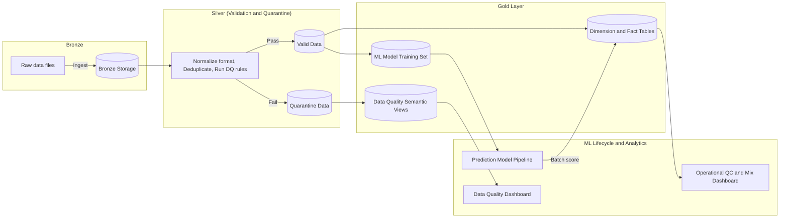

# Development Report

> The structure of this report follows the [INFORMS analytics framework](https://www.informs.org/Professional-Development/INFORMS-Analytics-Framework).

**Project Name:** BuhosAPI (Concrete Compressive Strength Prediction)

**Project Artifacts:**

- [Main Repository](https://github.com/jcdcustodio/buhos-api)
- [Cloud API Link](https://buhos-api-cloud.vercel.app/docs)

## 1. Business Problem Framing

- **Problem Statement:** Traditional empirical concrete mix design methods (such as the ACI method) are iterative, time-consuming, and overly conservative, often requiring excess cement and materials to guarantee target strength, which inflates costs and carbon footprint. Conversely, site-prepared nominal mixes (e.g. 1:2:4 volume ratios) frequently fail to achieve consistent target strengths because they rely on rough estimates rather than tested material proportions.
- **Intended Users & Actionable Decisions:** Civil/structural and materials engineers, batching plant operators, and researchers. The solution supports deciding exact component weights (cement, supplementary cementitious materials, aggregates, water, and superplasticizer) to safely and economically hit a target compressive strength, while establishing quality control (QC) baselines for batch production.
- **Scope & Constraints:** The current scope delivers a proof-of-concept predictive API supported with a data pipeline built on historical lab test data. Physical ingredient testing and environmental site assessments remain outside system scope, and inverse mix optimization is scoped as a future extension.
- **Success Measure:** Predict 28-day (and multi-age) concrete compressive strength in MPa within accepted accuracy range and evaluate mix designs against standard empirical baselines without relying on manual, trial-and-error batching.

## 2. Analytics Problem Framing

- **Analytics Objective:** Predict concrete compressive strength ($f'_c$ in MPa) from ingredient mass proportions ($kg/m^3$) and curing age (days), and track prediction residuals to support concrete quality control.
- **Key Analytics Questions:**

 1. What will be the compressive strength of a specific concrete mix at a given curing age?
 2. How do observed test results compare against historical trends and model predictions (residuals and statistical process control metrics)?
 3. How can material quantities be adjusted to optimize design mixes while maintaining target strength?

- **Metrics & Granularity:** Evaluated at the individual concrete test sample grain (`sample_id`) across curing ages ($\ge 1$ day, with 28 days as the industry benchmark). Model performance is measured using Root Mean Squared Error (RMSE), Mean Absolute Error (MAE), Mean Absolute Percentage Error (MAPE), and $R^2$. Operational QC tracks actual vs. predicted strength residuals, 3-test moving averages, 30-test rolling standard deviations, and cumulative sum (CUSUM) residuals.
- **Acceptance Criteria:**
  - Predictive model must outperform a simple linear baseline on held-out test data.
  - Automated data quality rules must quarantine invalid records prior to model training.
  - The API must reliably serve JSON predictions via `/predict` and status checks via `/health`.

## 3. Data

### Source List & Governance

All data is sourced from public academic repositories for reproducibility and peer review, configured via `sources.yaml`:

- **UCI Machine Learning Repository (`src1`):** 1,030 observations of concrete compressive strength tests ([Dataset Link](https://archive.ics.uci.edu/dataset/165/concrete+compressive+strength)).
- **CICLAB-NTUST High Performance Concrete Data (`src2`):** 597 observations of high-performance concrete mixes ([Dataset Link](https://figshare.com/articles/dataset/High_Performance_Concrete_Data/25139018)).
- **Grain & Access:** One row represents a single cured concrete cylinder/cube test sample (`sample_id`). No personally identifiable or sensitive data is present.

### Data Dictionary

#### Core Variables

| Field Name             | Meaning                                                                           | Data Type | Example       |
| ---------------------- | --------------------------------------------------------------------------------- | --------- | ------------- |
| `sample_id`            | Deterministic test sample surrogate key                                           | String | `a1b2c3d4...` |
| `mix_design_id`        | MD5 hash of 8 rounded ingredient masses                                           | String | `9f8e7d6c...` |
| `cement`               | Cement content ($kg/m^3$)                                                         | Float  | `402.0`       |
| `blast_furnace_slag`   | Blast furnace slag content ($kg/m^3$)                                             | Float  | `0.0`         |
| `fly_ash`              | Fly ash content ($kg/m^3$)                                                        | Float  | `0.0`         |
| `silica_fume`          | Silica fume content ($kg/m^3$)                                                    | Float  | `0.0`         |
| `coarse_aggregate`     | Coarse aggregate content ($kg/m^3$)                                               | Float  | `992.0`       |
| `fine_aggregate`       | Fine aggregate content ($kg/m^3$)                                                 | Float  | `732.0`       |
| `water`                | Mixing water content ($kg/m^3$)                                                   | Float  | `205.0`       |
| `superplasticizer`     | Superplasticizer admixture ($kg/m^3$)                                             | Float  | `0.0`         |
| `age` (`age_days`)     | Curing age in days                                                                | Integer | `28`         |
| `compressive_strength` | Measured compressive strength (MPa) - the target variable in the prediction model | Float | `38.50`       |

#### Derived Features (for ML)

| Field Name     | Meaning                                                                                                                                                           | Data Type | Example |
| -------------- | ----------------------------------------------------------------------------------------------------------------------------------------------------------------- | --------- | ------- |
| `log_age`      | Curing age transformed into logarithmic scale using natural logarithm of **1 + x**                                                                                | Float     | `3.367` |
| `ratio_wb`     | Water-binder ratio, the ratio of the amount of water and the total amount of binding materials (cement and supplementary cementitious materials or SCMs) in a mix | Float     | `0.50`  |
| `pct_scm_repl` | Percentage of binding material replaced with SCMs, calculated as the ratio of the amount of SCMs and the total amount of binding materials                        | Float     | `0.30`  |

### Pipeline Architecture & Preparation Scripts

Data flows through a local DuckDB medallion architecture orchestrated via Python scripts (`uv run`):

1. **Bronze (`ingest_source.py`):** Appends raw XLSX/CSV source files and ingestion metadata (`source_file`, `raw_row_num`, `ingested_at`) into Bronze tables.
2. **Silver (`build_silver.py`):** Normalizes formats, applies source defaults, deduplicates records, and runs automated data quality (DQ) checks. Passing rows enter Silver Valid; failing rows are routed to Silver Quarantine.
3. **Gold (`build_gold.py`):** Exports the clean ML training dataset, populates star-schema tables, and builds semantic views for operational QC and DQ monitoring.

### Data Quality Rules

Rather than silently dropping anomalies, failing records are isolated in Quarantine for auditing. The specific data quality rules implemented in the project are summarized as shown.

| Rule ID       | Data Quality Dimension | Table / Field                                                                          | Rule Condition                                                                      | Business Rationale                                                                             | Failure Action                                       |
| ------------- | ---------------------- | -------------------------------------------------------------------------------------- | ----------------------------------------------------------------------------------- | ---------------------------------------------------------------------------------------------- | ---------------------------------------------------- |
| **DQ-CMP-01** | Completeness           | All 9 input features + `compressive_strength`                                          | Non-null after applying source defaults (e.g., `silica_fume = 0.0` for `src1`)      | Missing mix weights or target strength corrupts binder ratios and model training.              | Route to Quarantine                                  |
| **DQ-VAL-01** | Validity               | All numeric feature & target columns                                                   | Values must parse cleanly to valid finite numbers (`DOUBLE` / `INTEGER`)            | Prevents text artifacts (e.g., `"N/A"`, stray headers) from entering Silver.                   | Route to Quarantine                                  |
| **DQ-VAL-02** | Validity               | `cement`, `water`, `coarse_aggregate`, `fine_aggregate`, `age`, `compressive_strength` | Strictly `> 0` (except `age >= 1` day).                                             | Concrete cannot exist without cement, water, aggregates, curing age, or positive strength.     | Route to Quarantine                                  |
| **DQ-VAL-03** | Validity               | `blast_furnace_slag`, `fly_ash`, `silica_fume`, `superplasticizer`                     | Greater than or equal to 0 (`>= 0`)                                                 | Supplementary cementitious materials (SCMs) and admixtures are optional ($0$), never negative. | Route to Quarantine                                  |
| **DQ-CON-01** | Consistency            | `source_id`, `silica_fume`                                                             | e.g., If `source_id == 'src1'` then `silica_fume == 0.0`                            | Enforces known dataset provenance.                                                             | Route to Quarantine                                  |
| **DQ-RSN-01** | Reasonability          | Fresh unit weight (sum of all ingredients)                                             | $2,100 \le \sum \text{ingredients} \le 2,600\text{ kg/m}^3$                         | Normal/high-performance concrete density must obey physical mass-volume bounds.                | Route to Quarantine                                  |
| **DQ-RSN-02** | Reasonability          | Water-to-binder ratio (`ratio_wb`)                                                     | 0.18 <= `water` / `total_binder` <= 0.95                                            | Ratios outside this range indicate unit conversion errors or unworkable/segregated mixes.      | Route to Quarantine                                  |
| **DQ-UNQ-01** | Uniqueness             | Business key: `(source_id, 8 ingredients, age, compressive_strength)`                  | Only the first ingested occurrence is kept in Silver; exact duplicates are flagged. | Prevents duplicate rows from inflating sample weights or leaking across CV folds.              | Keep first in Silver; route duplicates to Quarantine |

Exact row counts checked/quarantined per run are logged in the Gold DQ semantic view.

## 4. Methodology Selection

- **Method Justification:** Concrete compressive strength exhibits strong non-linear interactions between water-to-binder ratios, supplementary cementitious materials (SCMs), and curing age. Tabular gradient-boosted trees and ensemble methods capture these non-linearities effectively on ~1,600 tabular observations while remaining fast to train and interpret via SHAP values.
- **Baseline & Candidate Models:** Ridge Regression served as the simple linear baseline. Candidate models evaluated included Decision Tree, Random Forest, Support Vector Machines (SVM), and XGBoost.
- **Tool Choices:** Python 3.14 managed with `uv`, DuckDB for analytical storage, `scikit-learn` / `XGBoost` for modeling, `SHAP` for explainability, `FastAPI` for serving, and Docker (container) and Vercel (cloud) for deployment.
- **Evaluation & Splitting Plan:** Data was split using a stratified 60% Train / 20% Validation / 20% Holdout Test split stratified by data source (e.g. `src1` vs. `src2`) to prevent source distribution skew. Shortlisted models were tuned using 10-fold stratified cross-validation on the combined 80% Train+Validation pool before final evaluation on the untouched 20% Test set.

## 5. Analytics and Model Development

- **Development Artifacts:** Exploratory analysis, feature engineering, model tuning, training pipelines, web service, and reference cross-checks are implemented in the following links.
  - [EDA and feature engineering](https://github.com/jcdcustodio/buhos-api/blob/main/nb_eda_fe.ipynb)
  - [Model development](https://github.com/jcdcustodio/buhos-api/blob/main/nb_model_dev.ipynb)
  - Training ([notebook](https://github.com/jcdcustodio/buhos-api/blob/main/nb_train_script.ipynb) and [script](https://github.com/jcdcustodio/buhos-api/blob/main/train.py))
  - [Web service script](https://github.com/jcdcustodio/buhos-api/blob/main/predict.py)
  - [Reference calculations](https://github.com/jcdcustodio/buhos-api/blob/main/nb_refcalcs.ipynb)
- **Validation & Model Comparison:** After evaluating baseline models with and without engineered ratio features, feature pruning was guided by permutation importance and SHAP values. **XGBoost** achieved the strongest cross-validation performance across all regression metrics:

| Model | MAE (MPa) | RMSE (MPa) | MAPE | $R^2$ | Adjusted $R^2$ |
| ----------------------- | ---------- | ---------- | ------------------ | ---------- | -------------- |
| **XGBoost (fine-tuned)** | **3.4849** | **5.4300** | **0.1100** (11.0%) | **0.9189** | **0.9182** |

### Key Findings

1. **Observation:** Engineered domain ratios, specifically water-to-binder ratio (`ratio_wb`) and SCM replacement percentages alongside curing `age` , substantially improve predictive accuracy over raw ingredient weights alone.

- **Supporting Evidence:** Feature importance and SHAP summary plots confirm `age`, `ratio_wb`, and binder composition as dominant drivers, yielding $R^2 = 0.9189$ and $\text{MAE} = 3.48\text{ MPa}$.
- **Suggested Action:** Use the trained XGBoost model to screen candidate mix designs prior to physical trial batching and establish expected strength benchmarks in `SEM_QC_ANALYTICS`.
- **Limitation:** Predictions reflect laboratory curing conditions in historical datasets and do not account for local aggregate moisture variability, ambient curing temperatures, or admixture brand differences.

1. **Observation:** Public concrete datasets contain exact duplicate test records and edge-case mix proportions that violate physical concrete density bounds.

- **Supporting Evidence:** Silver-layer DQ checks (`DQ-UNQ-01`, `DQ-RSN-01`, `DQ-RSN-02`) isolate duplicate rows and out-of-range unit weights before Gold export.
- **Suggested Action:** Enforce Silver quarantine rules on all future batch plant data ingestions to prevent data leakage and model drift.
- **Limitation:** Quarantine rules currently flag anomalies for manual review rather than auto-correcting unit conversion errors.

1. **Observation:** Residual tracking (`actual_strength_mpa - predicted_strength_mpa`) enables statistical process control (SPC) across production batches.

- **Supporting Evidence:** Gold view `SEM_QC_ANALYTICS` computes 3-test moving averages, 30-test rolling standard deviations, and CUSUM residuals.
- **Suggested Action:** Monitor CUSUM residual trends in the operational QC dashboard to detect gradual material quality shifts early.
- **Limitation:** SPC rolling windows require chronological batch timestamps, whereas public historical datasets only provide raw row order.

## 6. Deployment

- **Access & Workflow:**

 1. **Pipeline & Training:** Run `ingest_source.py` $\rightarrow$ `build_silver.py` $\rightarrow$ `build_gold.py train` $\rightarrow$ `train.py` to produce the serialized model artifact (`csp_model.joblib`).
 2. **Inference Service:** Users send a `POST` request with the 8 ingredient masses and `age` to `/predict` (or check `/health`) via the cloud deployment (\[Cloud API Endpoint Placeholder\]), local Uvicorn server (`port 1313`), or Docker container (`buhos-api:v0.1.0`).

- **Setup & Reproducibility:** Complete dependency specifications (`pyproject.toml` using `uv`), `Dockerfile`, and sample client scripts (`sample_predict.py`, `sample_request.py`) are documented in README.
- **Fallback & Rollback Plan:** Because `csp_model.joblib` is versioned and decoupled from raw ingestion, if a data refresh fails DQ validation or degrades test metrics, `build_gold.py` halts export and the API continues serving the last validated `.joblib` artifact. Cloud deployments on Vercel can be rolled back immediately to the previous commit/deployment.

- **Prototype Verification (Simulated User Test):**

| Task Attempted                                 | Expected Result                                | Actual Result                                                             | Feedback / Verification                          | Change Made                                                                   |
| ---------------------------------------------- | ---------------------------------------------- | ------------------------------------------------------------------------- | ------------------------------------------------ | ----------------------------------------------------------------------------- |
| Send valid 28-day mix JSON via `POST /predict` | HTTP 200 with predicted strength in MPa        | Returned valid JSON prediction                                            | Confirmed API schema and feature pipeline parity | Added `sample_request.py` and curl examples to README                         |
| Execute end-to-end DuckDB medallion scripts    | Clean Gold tables and quarantined invalid rows | Validated records loaded to Gold; anomalies isolated in Silver Quarantine | Needed clear CLI sequence for rebuilds           | Documented step-by-step `uv run` commands in README doc for the data pipeline |

Operationalization Note: Moving from prototype to live batching plant use requires adding authentication, automated scheduled ingestion from plant batch controllers, and an inverse-optimization endpoint.

## 7. Analytics Solution Lifecycle Management

Shown below is a proposed plan for managing the project. This can be further improved depending on actual condition.

| Lifecycle Area             | Owner                            | Schedule                                  | Check / Metric                                                                            | Trigger Threshold                                                  | Response / Action                                                                                        |
| -------------------------- | -------------------------------- | ----------------------------------------- | ----------------------------------------------------------------------------------------- | ------------------------------------------------------------------ | -------------------------------------------------------------------------------------------------------- |
| **Data Pipeline & DQ**     | Project Owner (Individual)       | Upon new dataset or plant batch ingestion | Silver Quarantine rate & `DQ-*` rule failures in `SEM_QC` / DQ view                       | Any schema parse failure (`DQ-VAL-01`) or $> 5\%$ quarantine spike | Pause Gold export, retain prior `csp_model.joblib`, and inspect quarantined rows.                        |
| **Model Accuracy & Drift** | Project Owner (Individual)       | Monthly or every 200 new cylinder breaks  | Holdout/production MAE, RMSE, and `cusum_residual_mpa`                                    | Rolling MAE exceeds $5.0\text{ MPa}$ or sustained CUSUM drift      | Re-run `train.py` with updated Gold data, re-tune hyperparameters, and redeploy if test metrics improve. |
| **API Availability**       | Project Owner (Individual)       | Automated / pre-use check                 | `GET /health` HTTP status and response latency                                            | Non-200 status or timeout                                          | Inspect Vercel logs / Docker container and roll back to last working image/commit.                       |
| **Business Value Review**  | Project Owner & Domain Reviewers | Quarterly / post-pilot                    | Material savings ($kg/m^3$ cement reduction) & strength pass rate vs. ACI empirical mixes | Benefits remain unverified until observed in live plant trials     | Integrate inverse mix optimization once forward prediction reliability is validated in field use.        |

## 8. References

1. American Concrete Institute (2022). Selecting proportions for normal-density and high-density concrete - Guide (ACI PRC-211.1-22). American Concrete Institute.
2. Cheng, M.-Y., Cao, M.-T., & Dao-Thi, N.-M. (2023). A novel artificial intelligence-aided system to mine historical high-performance concrete data for optimizing mixture design. Expert Systems with Applications, 212, Article 118605. <https://doi.org/10.1016/j.eswa.2022.118605>
3. Yeh, I.-C. (1998). Modeling of strength of high-performance concrete using artificial neural networks. Cement and Concrete Research, 28(12), 1797–1808. <https://doi.org/10.1016/S0008-8846(98)00165-3>
